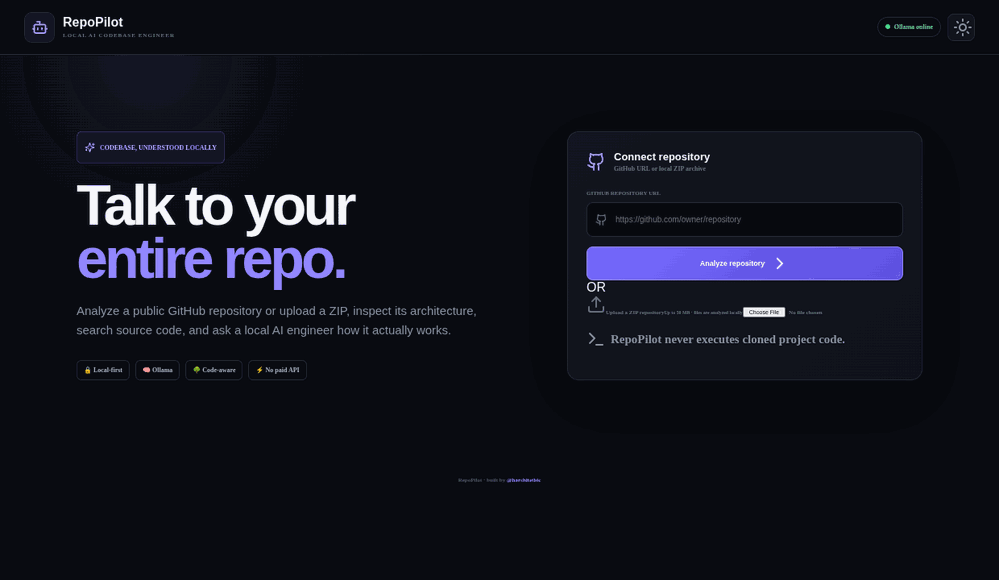
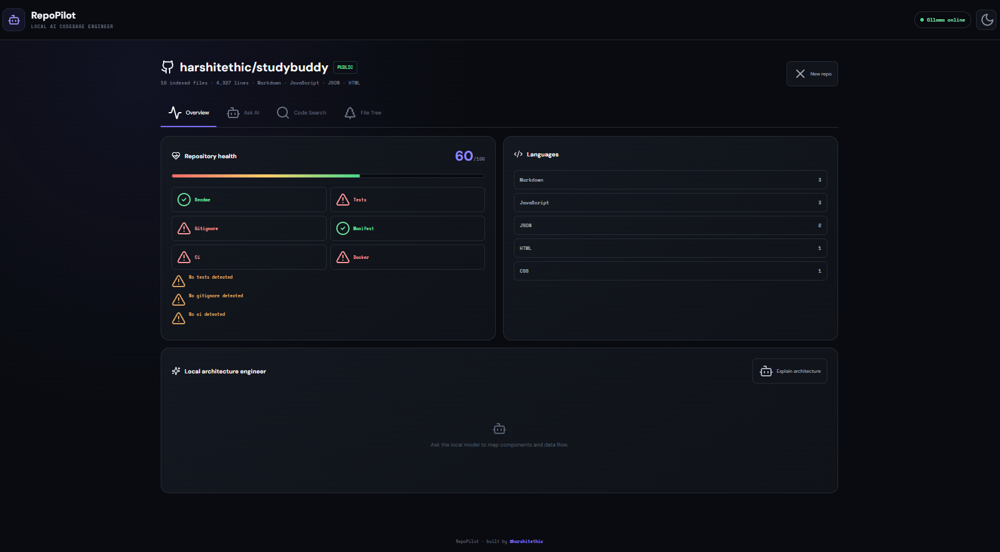
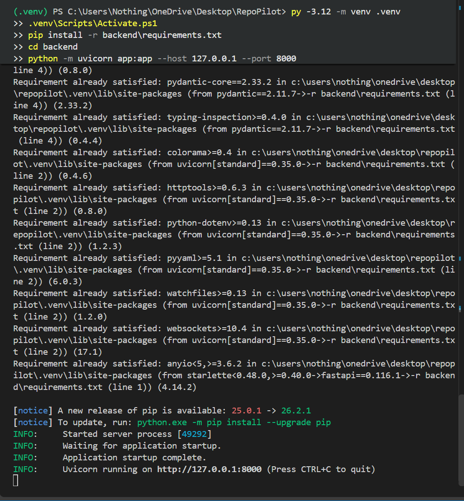

# RepoPilot

**Explore unfamiliar codebases locally. Import a repository, browse files, search real source lines, and optionally ask a local AI model.**

**Try it without any AI model:** [Independent first-run and isolation review](docs/independent-evaluation.md) · [Report a reproducible issue](https://github.com/harshitethic/RepoPilot/issues/new/choose). Synthetic demonstrations are identified as fixtures.

Built with **FastAPI, React, Vite, Git and optional Ollama**. RepoPilot runs on a trusted local workstation: you do not need a paid API key, or any model at all to import ZIPs and search source.

The browser walkthrough uses a **real FastAPI/Vite app** and controlled ZIP repositories. Its delayed AI response comes from a **test fixture**, not a production LLM. [Test design and screenshots](docs/browser-demo.md).

## What you can do

- Upload a ZIP **or** clone a public HTTPS GitHub repository on supported POSIX systems.
- Browse source trees, search indexed code with file/line references, and inspect language statistics.
- View a transparent, **heuristic** repository-health summary. It is not a security score.
- Optionally ask a local Ollama model about a source file or the overall architecture.
- Switch between projects without leaking stale search or AI responses from another repository.

| Dashboard | Source search |
| --- | --- |
|  |  |

**Scope:** a trusted, loopback-only developer workstation. This is not an authenticated multi-user service or an independently audited untrusted-code sandbox.

## Quick start

See the [cross-platform first-run guide](docs/first-run.md) for detailed steps and troubleshooting.

**macOS/Linux**, two terminals, Python 3.12 and Node.js **20.19+ or 22.12+** recommended (React 19 / Vite 8; [compatibility notes](docs/frontend-compatibility.md)):

~~~bash
git clone https://github.com/harshitethic/RepoPilot.git
cd RepoPilot
python3 -m venv .venv
source .venv/bin/activate
python -m pip install -r backend/requirements.txt
cd backend
python -m uvicorn app:app --host 127.0.0.1 --port 8000
~~~

In a **second terminal** from the checkout root:

~~~bash
cd frontend
npm ci
npm run dev
~~~

Open **http://localhost:5173**. ZIP import, file-tree browsing and search work **without Ollama**.

**Windows PowerShell**, ZIP uploads and search (backend GitHub cloning is intentionally disabled on Windows until equivalent subprocess supervision exists):

~~~powershell
git clone https://github.com/harshitethic/RepoPilot.git
cd RepoPilot
py -3.12 -m venv .venv
.\.venv\Scripts\Activate.ps1
python -m pip install -r backend\requirements.txt
cd backend
python -m uvicorn app:app --host 127.0.0.1 --port 8000
~~~

In another PowerShell terminal from the checkout root: change to **frontend**, run **npm ci** followed by **npm run dev**, and open **http://localhost:5173**.

### Optional local AI

Install [Ollama](https://ollama.com/) and download a model:

~~~bash
ollama pull llama3.2:1b
~~~

The backend defaults to **llama3.2:1b** at **http://127.0.0.1:11434**; set the **OLLAMA_MODEL** and/or **OLLAMA_URL** environment variables before starting the backend to change these values. Without a running Ollama instance, the AI endpoints report unavailable instead of inventing responses.

### Repeatable demo without a model

For a reproducible public example, run `python examples/create_demo_zip.py --output fictional-catalog.zip`
from the checkout root on macOS, Linux or Windows PowerShell. Import the ZIP and
search for `find_title` at `src/catalog.py:2`. CI verifies the published
example and its real HTTP import/search/delete flow. See [first run](docs/first-run.md).

The real HTTP smoke test uses disposable ZIP fixtures and synthetic answers:

~~~bash
python -m pip install -r backend/requirements-test.txt
PYTHONPATH=backend python -m unittest discover -s backend/tests -p test_http_smoke.py -v
~~~

Windows PowerShell equivalents and what the demo does **not** verify are in the [first-run guide](docs/first-run.md).

## Architecture

~~~text
React / Vite frontend (localhost:5173)
              |
         /api/* proxy
              |
FastAPI (127.0.0.1:8000)
     |           |            |
 ZIP / Git    Index/search   Optional Ollama
  import         |            |
     +-------- private local workspaces
~~~

The API provides ZIP/Git import, repository inventory/deletion, source search, health and optional architecture/answer endpoints. See the [real HTTP walkthrough](docs/http-smoke-test.md).

## Test evidence and threat model

- Backend regression tests, independently run in CI on Python **3.11, 3.12 and 3.13**.
- Three frontend health-contract tests, production Vite build, and a real-browser test uploading/searching two repositories while a delayed AI response arrives.
- Python and JavaScript CodeQL extended security analysis on PRs and main.
- Documented failure injection and limitations instead of claims of perfect security.

| Boundary | Reproduction and limitations |
| --- | --- |
| ZIP traversal, duplicates and extraction | [ZIP threat model](docs/zip-ingestion-security.md) |
| HTTPS Git validation and config isolation | [Git import model](docs/github-import-security.md) |
| Git subprocess wall/CPU/file limits | [POSIX process limits](docs/git-process-limits.md) |
| Default 1 import / 2 AI requests across processes | [Work admission](docs/concurrent-work-admission.md) |
| Upload caps before multipart parsing | [Request-body limits](docs/request-body-admission.md) |
| Persistent logical storage quota | [Storage budget](docs/import-storage-budget.md) |
| Real backend/browser and synthetic model reply | [Browser evidence](docs/browser-demo.md) |
| Loopback API boundary | [API security model](docs/local-api-boundary.md) |

**Known limitations:** The API has no multi-user authentication. Peak temporary disk, network, server buffers and aggregate CPU/RSS across Git descendants are not fully bounded. Linux applies a per-process virtual-address-space cap to Git; macOS does not. ZIP processing and local Ollama are not inside containers here. Windows backend Git import fails closed. Do not expose the API to the internet without a separate security design.

## Contributing

Reproducible bug reports, onboarding feedback and focused tests are welcome. See [CONTRIBUTING.md](CONTRIBUTING.md), use synthetic fixtures and keep keys/private repositories out of issues and pull requests.

## License

[MIT](LICENSE) © 2026 Harshit Sharma.
