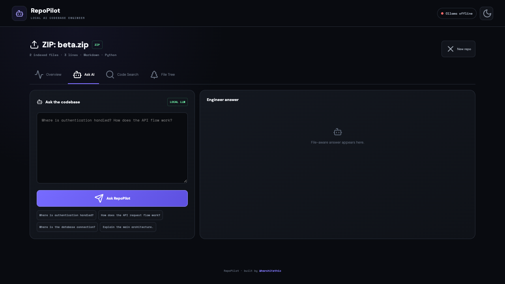

# RepoPilot live browser walkthrough — verified local session

This animated recording consists of **42 frames captured from Chromium**
connected to a **real FastAPI backend and Vite/React frontend** on a Kali
Linux computer. It is not a design mockup. The entire demo uses a
synthetic, six-file fictional catalog ZIP and no personal repositories,
credentials, private messages or paid model APIs.

## What the browser actually did

1. Load the React landing page and retrieve the local backend health status.
2. Upload a ZIP through the real file-input form to POST /api/upload.
3. Index and analyze six text files, yielding the repo overview and health score.
4. Search the real indexed source for search_catalog; show
   src/catalog.py among the returned search results.
5. Browse the six-file tree and return to the repository overview.

The original capture predates the structured health response change;
the current API returns `{"ok": true, "ollama": {"online": false, "models": []}}`
when the local model is unavailable. No language-model answers were generated
or represented in the original GIF.

## Reproduce locally (two terminals)

Use a trusted local computer with Python 3.11+, Node 20+ and Git:

    git clone https://github.com/harshitethic/RepoPilot.git
    cd RepoPilot
    python3 -m venv .venv
    .venv/bin/python -m pip install -r backend/requirements-test.txt

Start the API in the first terminal:

    PYTHONPATH=backend .venv/bin/python -m uvicorn app:app --host 127.0.0.1 --port 8000

Start the frontend in the second terminal:

    cd frontend
    npm ci
    npm run dev -- --host 127.0.0.1 --port 5173

Generate the **same six-file synthetic input** from the repository root:

    python3 examples/create_demo_zip.py --output /tmp/fictional-catalog.zip

Open http://127.0.0.1:5173/ on the same machine. Upload the ZIP, select
Code Search, search for search_catalog, and open File Tree. The source
fixture and import behavior are also checked by the network-free
backend/tests/test_browser_demo_fixture.py regression.

## Independent browser isolation regression

The second image comes from a successful headless Chrome regression run
on a Mac. The test exercises the **actual FastAPI and React/Vite servers**,
real ZIP multipart upload, extraction, indexing, and search, with two
different synthetic repositories containing `alpha_marker` and
`beta_marker`. It first confirms that Repo A search works, then begins a
Repo A model-answer request against the real API. The browser harness
captures the actual API response but delays delivering it to React. While
that response is pending, the browser switches to Repo B and searches its
source; the browser harness releases the Repo A response **after** Repo B
is loaded. It asserts that neither Repo A's
search results nor its returned AI answer appear in Repo B's UI.

Only the final local-language-model response is a deterministic stub; the
rest of the backend is real. This proves stale-result isolation for this
scenario, not inference quality or comprehensive multi-tenant security.

Reproduce with Python and Node dependencies installed and Google Chrome
installed locally (CI installs Playwright Chromium instead):

    cd frontend
    npm ci
    REPOPILOT_PYTHON=../.venv/bin/python npm run test:e2e

The browser harness binds solely to loopback and creates a disposable
temporary repository workspace. The test's browser-network interception is used solely to reproduce a
late API response; it does not alter the normal application.

## Verification and limitations

- The original Kali session passed landing, upload, search, tree and
  overview assertions against the actual localhost API.
- The committed GIF captures the visible UI at the stated steps. It
  is **not** a high-frame-rate video or evidence of production traffic.
- CI includes the generated fixture import/search test, structured health-contract
  tests, frontend build, the real-browser isolation scenario, and CodeQL security analysis.
- The demo does not prove GitHub login, remote inference quality, reliable
  multi-tenant operation, model safety or production-readiness.
- RepoPilot is a trusted **local developer tool**. Do not bind its
  unauthenticated backend publicly to the Internet.

See [GitHub clone boundaries](github-import-security.md) and
[ZIP ingestion boundaries](zip-ingestion-security.md).